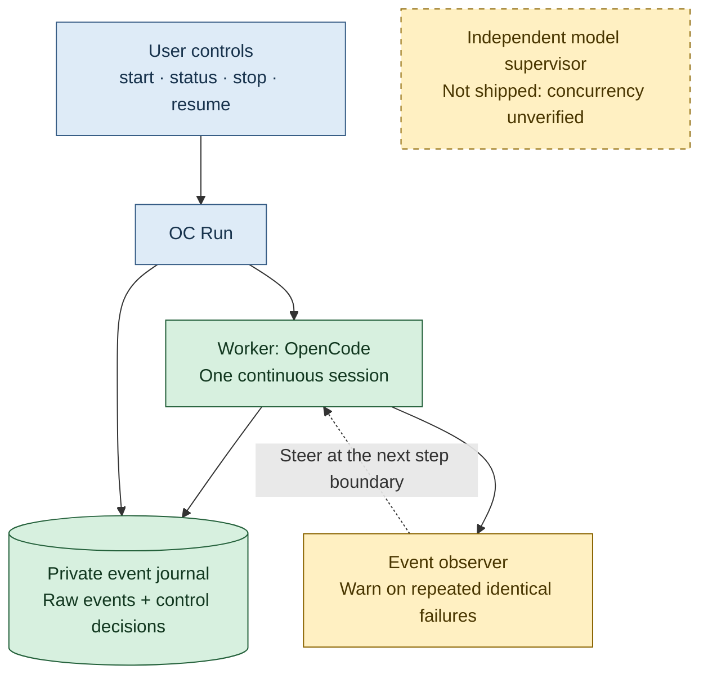

# OC Run

Give [OpenCode](https://opencode.ai/) a task and a working budget.
Let it work continuously. Check progress, request a safe stop, then resume later.

A small Python controller for long coding and research tasks.
One worker. No milestone review calls.



The observer uses tool outcomes, not private reasoning or model calls.
Independent model supervision is not included.

## Quick start

Needs macOS or Linux, Python 3.10+, Git and a configured OpenCode provider.
Tested with OpenCode 2.0.28's native V2 APIs.

Inspect this checkout, then install the local executable:

```sh
mkdir -p ~/.local/bin
install -m 755 oc-run ~/.local/bin/oc-run
```

Keep `~/.local/bin` on your PATH. Back up any old installation. In your project:

```sh
oc-run 10h "Research and improve this project"
```

Your model, tools and permissions stay configured as before.
The budget requests a handoff. No fixed rounds or silence timeouts.
It is a cooperative working deadline, not a hard wall-clock kill: an active action
can overrun it. No provider recovery starts after stop or budget end.

## Commands

```sh
oc-run status
oc-run stop --latest          # request a safe handoff; return promptly
oc-run stop --latest --force  # interrupt the active invocation
oc-run handoff --latest
oc-run resume 2h --latest     # inspect interrupted work; give a new budget
```

- `--run /path/to/run` selects a recorded run explicitly.
- Controls select only the current directory's active run, then its newest.
- `handoff --latest` also allows historical runs from other directories.
- `--dry-run` shows intent without starting OpenCode or creating state.
- Non-Git workspaces require `--project-root /path/to/project` on start and resume.
  Use the same root from nested directories. Controls still select runs by working directory.
- `--push` permits checked, reviewed pushes. Off by default.
- Durations: `s`, `m`, `h`. Bare numbers mean minutes.
- Reported completion stops by default.

Soft stop saves the request and uses OpenCode's native steering inbox.
`status` shows pending, confirmed, rejected or uncertain admission. Confirmed means
accepted by OpenCode; delivery waits for a step boundary. Unknown outcomes are
reconciled before retrying the same message ID. `CONTROL.md` is the fallback.
There is no automatic escalation. Resume starts a new budget and clears stale steering.

Force stop, Ctrl-C, SIGTERM and terminal closure interrupt work.
Cleanup sends TERM, then KILL to managed process groups. Other OpenCode services
are untouched. `status` distinguishes stopping, stopped and interrupted runs.

## Recovery and safety

Private state lives in `~/.local/state/oc-run`, outside your project:

| File | Purpose |
| --- | --- |
| `HANDOFF.md` | Short account of work, failures, uncertainty and next steps |
| `run.json` | Small control snapshot, session ID and recent excerpts |
| `*-work.jsonl` | Incremental native OpenCode events |
| `journal.jsonl` | Session identity, requests, warnings and state transitions |

Raw logs remain complete. Parsing skips records above 1 MiB and continues at the
next newline. Summaries retain the last 65,536 text characters, 32 recent facts per kind
and updates for 256 recent tool calls. Older call updates may count separately;
inspect raw logs when a summary is limited. Invocation Markdown files are excerpts.
Oversized old snapshots remain readable. Resume preserves the original in `legacy-state.json` before compacting it.

Keep logs private: they may contain secrets. `OC_RUN_STATE_DIR` selects another
private directory outside the Git or declared non-Git workspace, including resolved
symlink paths. Locks prevent overlapping workers using the same workspace identity
and state directory. Git uses its common directory. Non-Git roots are explicit;
separately declared overlapping roots cannot be detected. Unrelated roots remain independent.

After a crash, resume preserves partial logs, reconstructs complete events and
checks OpenCode's persisted session. The worker must inspect files, jobs and
uncertain side effects before repeating non-idempotent actions. Legacy handoffs
remain readable.

After a terminal provider transport/timeout error, or the specific Sage prefill
OOM reporting that caches were cleared and the engine remains up, OC Run permits
at most two extra invocations per start/resume (2s then 4s backoff). OpenCode has its
own bounded request retries before this. Persistent OOMs can still fail.

Recovery continues the original session only after native checks find no active
session, child session, queued input or managed shell. Missing native state,
uncertain/timed-out tools and other errors stop with a diagnostic. Child sessions
conservatively require manual inspection. There is no blind new-session fallback.
The worker must inspect saved results and jobs before continuing; completed tools
are never replayed by the controller.

A missing or malformed `OC_RUN_RESULT` gets one handoff-only repair opportunity,
sharing the same two-invocation recovery allowance. Each handoff invocation is
limited to 120s. It requests no tools or experiments and may report incomplete.
If repair fails, `HANDOFF.md` still records observed tool counts, errors, Git state,
session identity and raw-log paths; it never invents a research result.

The completion contract requires `decision: STOP`, boolean `complete`, non-empty
`reason`, `summary`, `next`, and a string-list `evidence`. A complete claim also
requires cited evidence and an observed successful tool. Exit 0 alone never meets
this contract. Tool errors stay historical and do not automatically fail a session;
shell timeout/signal/background metadata is not counted as completed evidence.

No agent or model flag is passed: OpenCode resolves project configuration and
preserves session selection on resume. Context limits, BF16 and KV precision are
unchanged. Research scheduling and memory headroom remain the agent's responsibility.

Raw logs use `fsync` on useful events and roughly one-second polling boundaries.
Control records are synced; atomic snapshots also sync their parent directory.
This requests filesystem durability, not guaranteed power-loss recovery.
Unsynced tokens and unrecorded effects may be lost. No physical reboot was tested.

## Limits and checks

- Four identical consecutive failures trigger one warning per invocation.
  Changed inputs or successful tools break the streak. Warnings never kill work.
- No reasoning-loop, drift or overengineering judgement. Only the bounded,
  checked recovery above is automatic; unknown process/provider errors stop.
- OpenCode 2.0.28 omits child-session events from the parent's CLI stream.
  Child tool failures and progress may be absent; inspect native sessions before recovery.
- Stop and Git rules are cooperative, not a sandbox. Detached jobs can escape
  cleanup and native recovery checks. Handoff-only instructions are also cooperative.
  Private-server teardown can terminate its own managed jobs. Unrelated process
  groups are untouched. Other OpenCode versions may change APIs or events.
- Exit `0`: model-reported completion with evidence and successful tools, not
  independent proof. Run your own acceptance checks. `3`: stopped/incomplete.
  `1`: invocation/report failure.
  `2`: setup error. Signals: `128 + signal`.

Run deterministic tests without a model:

```sh
python3 -m unittest discover -s tests -v
```

Set `OC_RUN_NATIVE_BIN` to the installed OpenCode executable to include native
CLI/server/tool integration tests with a loopback fixture provider, without model
inference. See [RELIABILITY.md](RELIABILITY.md) for the dated investigation and scope.

MIT licence. See [LICENSE](LICENSE).
