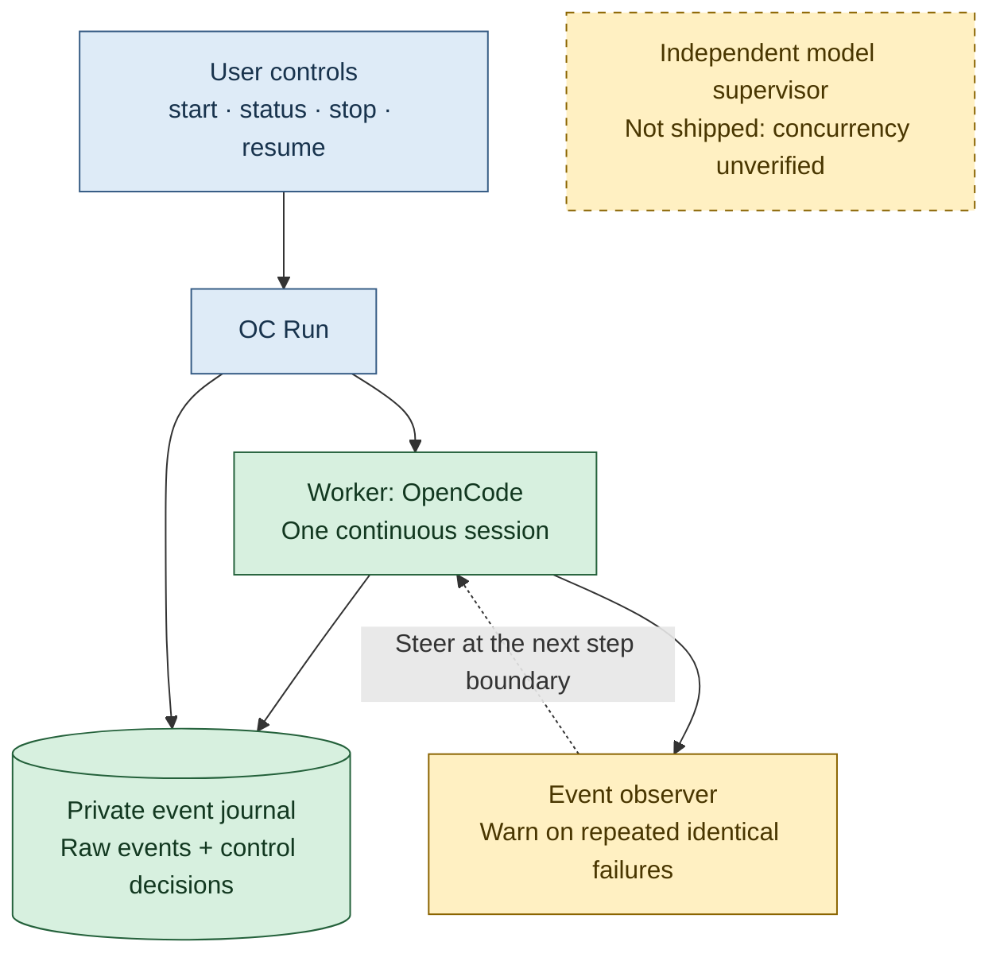

# OC Run

Give [OpenCode](https://opencode.ai/) a task and a working budget.
Let it work continuously. Check progress, request a safe stop, then resume later.

A small Python controller for long coding and research tasks.
One worker. No milestone review calls.



The observer uses tool outcomes, not private reasoning or model calls.
Independent model supervision is not included.

## Quick start

Needs macOS or Linux, Python 3.10+, Git and a configured OpenCode provider.
Tested with OpenCode 2.0.28's native V2 APIs.

Inspect this checkout, then install the local executable:

```sh
mkdir -p ~/.local/bin
install -m 755 oc-run ~/.local/bin/oc-run
```

Keep `~/.local/bin` on your PATH. Back up any old installation. In your project:

```sh
oc-run 10h "Research and improve this project"
```

Your model, tools and permissions stay configured as before.
The budget requests a handoff. No fixed rounds or silence timeouts.

## Commands

```sh
oc-run status
oc-run stop --latest          # request a safe handoff; return promptly
oc-run stop --latest --force  # interrupt the active invocation
oc-run handoff --latest
oc-run resume 2h --latest     # inspect interrupted work; give a new budget
```

- `--run /path/to/run` selects a recorded run explicitly.
- `--latest` prefers the current project's active run, then its newest.
- `--dry-run` shows intent without starting OpenCode or creating state.
- `--push` permits checked, reviewed pushes. Off by default.
- Durations: `s`, `m`, `h`. Bare numbers mean minutes.
- `--stop-when-done` is retained; completion now stops by default.

Soft stop saves the request and uses OpenCode's native steering inbox.
Delivery waits for the next step boundary; active operations can finish first.
`CONTROL.md` provides a fallback. There is no automatic escalation.

Force stop, Ctrl-C, SIGTERM and terminal closure interrupt work.
Cleanup sends TERM, then KILL to managed process groups. Other OpenCode services
are untouched. `status` distinguishes stopping, stopped and interrupted runs.

## Recovery and safety

Private state lives in `~/.local/state/oc-run`, outside your project:

| File | Purpose |
| --- | --- |
| `HANDOFF.md` | Short account of work, failures, uncertainty and next steps |
| `run.json` | Latest controller state and session ID |
| `*-work.jsonl` | Incremental native OpenCode events |
| `journal.jsonl` | Session identity, requests, warnings and state transitions |

Keep logs private: they may contain secrets. `OC_RUN_STATE_DIR` selects another
private directory. Repository locks prevent overlapping workers.

After a crash, resume preserves partial logs, reconstructs complete events and
checks OpenCode's persisted session. The worker must inspect files, jobs and
uncertain side effects before repeating non-idempotent actions. Legacy handoffs
remain readable.

Raw logs use `fsync` on useful events and roughly one-second polling boundaries.
Control records are synced; atomic snapshots also sync their parent directory.
This requests filesystem durability, not guaranteed power-loss recovery.
Unsynced tokens and unrecorded effects may be lost. No physical reboot was tested.

## Limits and checks

- Four identical consecutive failures trigger one warning per invocation.
  Changed inputs or successful tools break the streak. Warnings never kill work.
- No reasoning-loop, drift or overengineering judgement; no automatic restarts.
  Provider and process errors stop with evidence preserved.
- MTPLX 2.12.3 was installed but offline during validation. Sage-A1.5 concurrency,
  KV memory, cancellation and throughput remain unverified. The installed
  `mtp_batch` lane rejects this Sage pack's quantisation contract.
  [Its official concurrency guide](https://github.com/youssofal/MTPLX/blob/main/docs/concurrency.md)
  requires execution telemetry, not merely two connections.
- Stop and Git rules are cooperative, not a sandbox. Detached jobs can escape
  cleanup. Other OpenCode versions may change APIs or events.
- Exit `0`: model-reported completion with evidence and successful tools, not
  independent proof. `3`: stopped/incomplete. `1`: invocation/report failure.
  `2`: setup error. Signals: `128 + signal`.

Run deterministic tests without a model:

```sh
python3 -m unittest discover -s tests -v
```

MIT licence. See [LICENSE](LICENSE).
